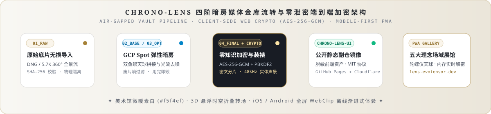

<div align="center">



# Chrono-Lens · 时空之镜 (`Chrono-Lens-UI`)

**记录山野微风、城市斜阳与身边真实世界的 360° 全景生活影像与端到端加密数字艺术展馆**

[](https://lens.evotensor.dev)
[](https://qqddtt.github.io/Chrono-Lens-UI/)
[](https://lens.evotensor.dev/vault.html)
[](LICENSE)

</div>

---

## ✨ 展馆序言与视觉哲学

欢迎来到 **Chrono-Lens（时空之镜）** 的公开静态前端仓库（`Chrono-Lens-UI`）。本工程承载线上艺术展馆 [https://lens.evotensor.dev](https://lens.evotensor.dev) 的纯静态渐进式 Web 应用（PWA）产物。

展馆摒弃传统网页密集网格与冗余文字堆砌，以温润的**美术馆微暖素白（Warm Gallery Alabaster, `#f5f4ef`）**为画布，通过 **3D 悬浮透视幻灯片展台**与**电影级时空折叠转场（Cinematic Portal Transition）**，连接五大独立艺术理念场域：

<div align="center">
  
</div>

---

## 🏛️ 五大艺术理念场域矩阵

| 理念场域 | 入口页面 | 空间美学母题 | 核心视听与交互亮点 |
| :--- | :--- | :--- | :--- |
| **🌌 展厅 01 ·「穹·极」** | [`panorama.html`](panorama.html) | 景泰蓝掐丝天球仪 · 无界之境 | 原生 WebGL / Three.js 360° 等距柱状天球投影，支持触屏阻尼漫游、移动端陀螺仪重力感应环视与高山双耳空间声景。 |
| **🌅 展厅 02 ·「晨·昏」** | [`daylight-salon.html`](daylight-salon.html) | 莫奈日出印象派光斑 · 廿四时相 | 纯棉无酸纸微肌理画廊、Display P3 宽色域自然光影呈现与 7.5 秒微呼吸光流过渡。 |
| **❄️ 展厅 03 ·「瞬·息」** | [`cinema.html`](cinema.html) | 35mm 穿孔胶片暗房 · 慢速微影 | 2.39:1 变形宽银幕暗箱放映厅，搭载双侧微缩链齿孔胶片导轨，呈现高山粉雪与深海巨浪 120fps 慢动作切片。 |
| **🔐 展厅 04 ·「重·温」** | [`vault.html`](vault.html) | 重型钛金古铜机械金库 · 零泄密 | 基于浏览器原生 Web Crypto API（`AES-256-GCM` + `PBKDF2`），密文分片仅在客户端内存凭口令实时解密，服务端零明文。 |
| **🎨 展厅 05 ·「重·构」** | [`studio.html`](studio.html) | 高温裂变珐琅与波普光谱 | 先锋视觉解构实验舱，提供黄金母版与超现实色彩重塑的双向无级对比滑杆与微故障声学脉冲。 |

---

## 📱 多终端全适配与离线 PWA 体验

1. **移动端竖屏优先设计（Mobile Portrait First）**：严格适配 `100dvh` 动态视口与系统安全区（`env(safe-area-inset-*)`），所有微圆点与浮空微气泡（Ghost Glyphs）均具备 $\ge 44\times 44\text{px}$ 安全触控热区，零横向滚动溢出。
2. **主屏幕全屏 WebClip 与 Service Worker**：内置 `manifest.json` 与 `service-worker.js` 离线缓存策略，支持在 iOS Safari 与 Android Chrome 中“添加到主屏幕”获得原生艺术画廊级无边框体验。
3. **45~60 秒美术馆级呼吸声景**：右上角浮空声景胶囊搭载真实物理音频资产（`assets/audio/` & `data/audio/`），支持跨场域等功率交叉淡入淡出。

---

## 🚀 本地离线运行与预览说明

本仓库为 **100% 纯静态零构建依赖产物**，无需安装任何 Node.js 或后端服务：

```powershell
# 方式一：直接双击打开 index.html 即可浏览主展馆与五大理念场域

# 方式二：使用任意轻量静态 HTTP 服务器（推荐，以启用 Service Worker 与 WebGL 纹理跨域加载）
npx serve .
# 或使用 Python 内置静态服务：
python -m http.server 8080
```

---

## 📄 许可证与版权声明 (License & Copyright)

- **前端 UI 框架代码**：本公开仓库（`Chrono-Lens-UI`）发布的脱敏纯静态前端框架与样式代码采用 **[MIT License](LICENSE)** 开源授权。
- **原创影像与声景作品版权保留**：站内展出的所有原创摄影照片、120fps 视频切片与 360° 全景影像作品著作权归 **Evotensor / Nick (QQDDTT)** 独家所有，未经书面许可严禁商用、篡改或用于训练第三方 AI 模型。
